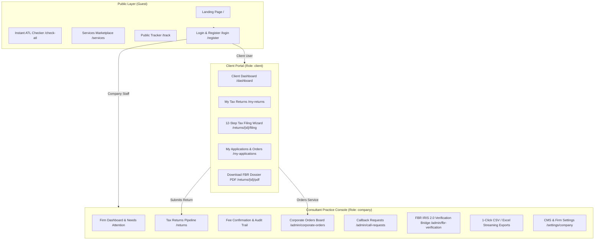
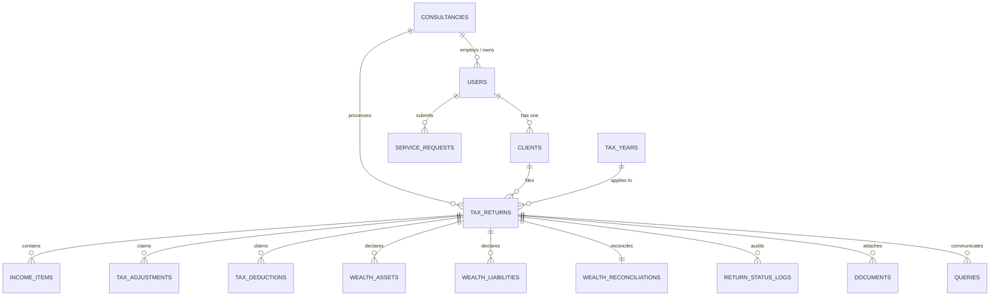
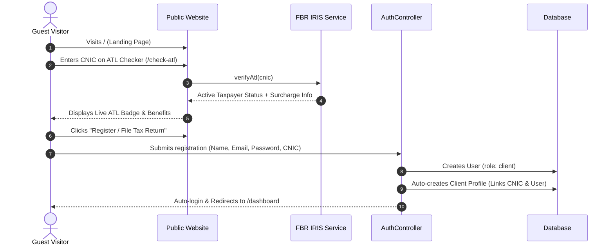
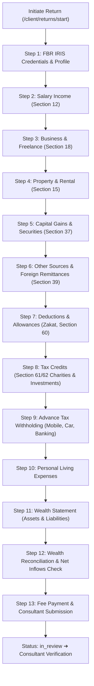
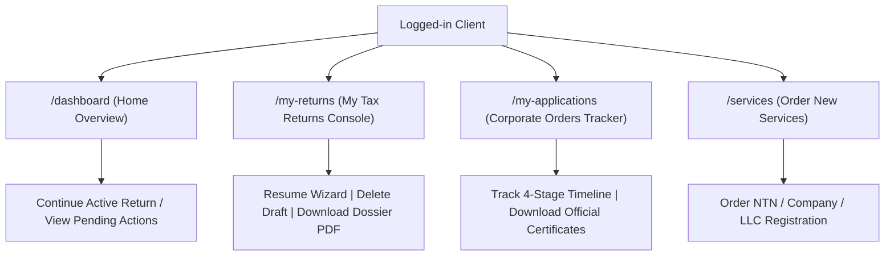
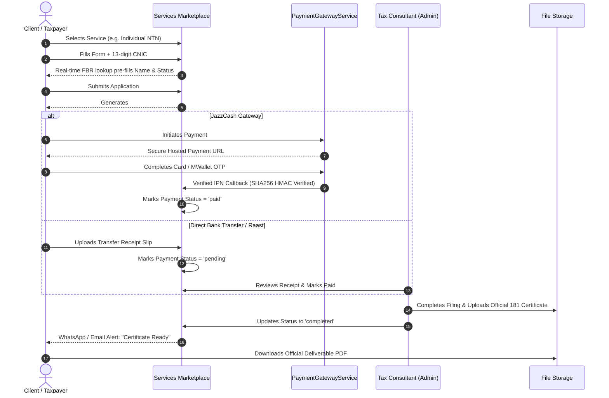
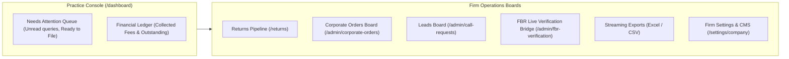
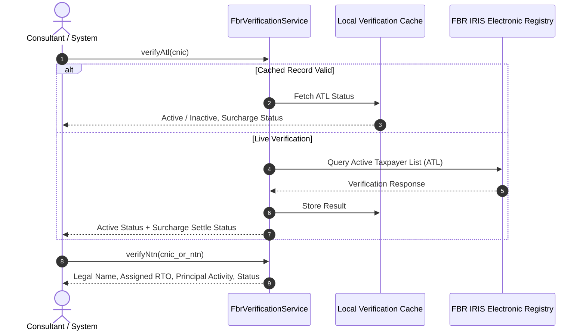
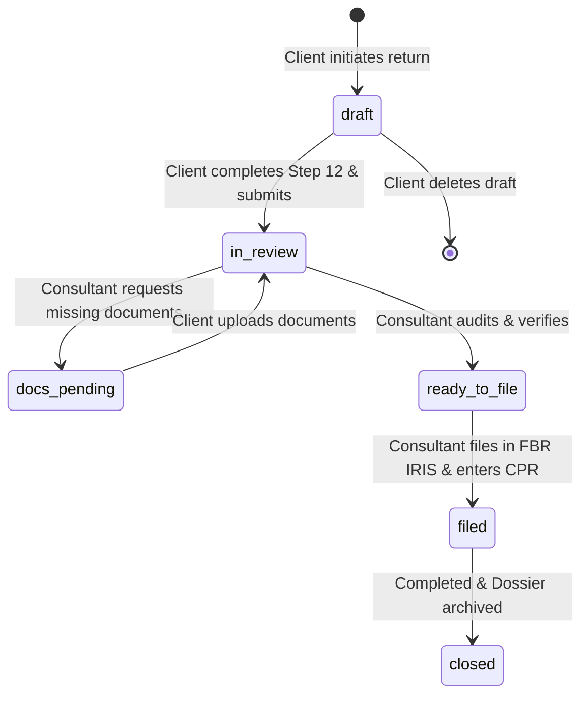

# Taxflilling Application Flow & Architectural Blueprint
**Platform:** TaxFiler.pk (Pakistan Digital Tax & Corporate Advisory Platform)  
**Stack:** Laravel 12/13 &bull; PHP 8.3+ &bull; Tailwind CSS v4 &bull; Alpine.js &bull; DomPDF &bull; SQLite / MySQL  
**Scope:** Complete End-to-End Functional, Technical, and System Workflow Specification  

---

## Table of Contents
1. [Executive Architecture Overview](#1-executive-architecture-overview)
2. [Actor Roles & Permissions (RBAC Matrix)](#2-actor-roles--permissions-rbac-matrix)
3. [Database Models & Entity Relationships (ERD)](#3-database-models--entity-relationships-erd)
4. [Flow 1: Public Website & Client Onboarding](#4-flow-1-public-website--client-onboarding)
5. [Flow 2: Individual Income Tax Return (12-Step Wizard)](#5-flow-2-individual-income-tax-return-12-step-wizard)
6. [Flow 3: Client Portal Operations (Returns & Applications)](#6-flow-3-client-portal-operations-returns--applications)
7. [Flow 4: Corporate & NTN Services Order Lifecycle](#7-flow-4-corporate--ntn-services-order-lifecycle)
8. [Flow 5: Consultant & Firm Operations Console (Admin)](#8-flow-5-consultant--firm-operations-console-admin)
9. [Flow 6: FBR IRIS 2.0 Integration & Verification Bridge](#9-flow-6-fbr-iris-20-integration--verification-bridge)
10. [Security Controls, IDOR Protections & State Machines](#10-security-controls-idor-protections--state-machines)

---

## 1. Executive Architecture Overview

TaxFiler.pk is a full-featured digital tax compliance and corporate filing platform modeled after Befiler and TurboTax, tailored specifically for Pakistan's Federal Board of Revenue (FBR) IRIS 2.0 regulations, Income Tax Ordinance 2001, and SECP corporate laws.

### High-Level Architecture Diagram

---

## 2. Actor Roles & Permissions (RBAC Matrix)

The application implements strict Role-Based Access Control via Laravel middleware (`role:client`, `role:company`) and policy gates (`TaxReturnPolicy`):

| Capability / Resource | Guest (Public) | Client (Taxpayer) | Company (Consultant/Admin) |
|---|:---:|:---:|:---:|
| View Landing, ATL Checker, FAQs, Contact | ✅ | ✅ | ✅ |
| Browse Business Services Catalog | ✅ | ✅ | ✅ |
| Real-time 13-digit CNIC FBR Status Check | ✅ | ✅ | ✅ |
| Public Track via Tracking # / CNIC | ✅ | ✅ | ✅ |
| Access Client Dashboard (`/dashboard`) | ❌ | ✅ | ❌ (Redirects to Firm View) |
| Dedicated "My Tax Returns" (`/my-returns`) | ❌ | ✅ | ❌ (403 Forbidden) |
| Dedicated "My Applications" (`/my-applications`) | ❌ | ✅ | ❌ (403 Forbidden) |
| 12-Step Tax Return Wizard | ❌ | ✅ (Own returns only) | ✅ (Assigned returns) |
| Delete Draft Tax Return | ❌ | ✅ (Draft & Unpaid only) | ✅ |
| Confirm Filing Fee Received | ❌ | ❌ (403 Forbidden) | ✅ |
| Transition Return Status (`in_review` ➔ `filed`) | ❌ | ❌ | ✅ |
| Corporate Orders & Leads Management | ❌ | ❌ | ✅ |
| FBR IRIS 2.0 Live Verification Bridge | ❌ | ❌ | ✅ |
| Streaming CSV / Excel Data Exports | ❌ | ❌ | ✅ |
| Manage CMS & Firm Pricing Settings | ❌ | ❌ | ✅ |

---

## 3. Database Models & Entity Relationships (ERD)

### Core Schema Definitions:
- **`users`**: Authentication identity (`name`, `email`, `password`, `role` [`client`|`company`], `consultancy_id`).
- **`clients`**: Permanent taxpayer master profile (`user_id`, `name`, `cnic`, `ntn`, `phone`, `email`, `masked_cnic`).
- **`tax_years`**: Fiscal periods e.g. July 1 &ndash; June 30 (`name`, `filing_deadline`, `is_active`).
- **`tax_returns`**: Annual return filings (`client_id`, `tax_year_id`, `status` [`draft`, `docs_pending`, `in_review`, `ready_to_file`, `filed`, `closed`], `fee_status` [`pending`, `paid`], `fee_amount`, `taxable_income`, `tax_payable`, `iris_acknowledgement_no`).
- **`wealth_reconciliations`**: Wealth balance sheet formula (`opening_wealth`, `net_inflows`, `living_expenses`, `other_outflows`, `closing_wealth`, `unreconciled_difference`).
- **`return_status_logs`**: Immutable audit log of status changes, who made them, and notes.
- **`service_requests`**: Corporate orders (NTN, STRN, Company, LLC) with 9-digit `tracking_number`, `fee_amount`, `payment_status`, `delivered_file_path`.
- **`callback_requests`**: Inbound client leads (`name`, `phone`, `service_code`, `status` [`pending`, `contacted`, `converted`, `closed`]).

---

## 4. Flow 1: Public Website & Client Onboarding

### Key Highlights:
1. **Public Services Hub (`/services`)**: Includes 5 corporate service categories (Income Tax, Sales Tax, Company Registration, IP/Trademark, USA LLC).
2. **On-the-fly CNIC Verification (`/services/check-cnic`)**: While a visitor types a 13-digit CNIC, an asynchronous Alpine.js request fetches live ATL active status, legal name, and NTN to pre-fill their application form instantly.
3. **Public Application Tracker (`/track`)**: Allows guest users to search real-time file status by 9-digit Tracking Number or masked CNIC.

---

## 5. Flow 2: Individual Income Tax Return (12-Step Wizard)

The tax filing workflow translates complex Pakistani income tax laws into an intuitive, guided self-service wizard (`/returns/{return}/filing`):

### Step-by-Step Breakdown:
1. **Step 1 (FBR Credentials & Profile)**: Client specifies CNIC, NTN, and either enters FBR credentials or authorizes the consultant to file on their behalf. Passwords and PINs are protected and never logged in plaintext.
2. **Step 2 (Salary Income - Section 12)**: Annual gross salary, exempt allowances (medical, conveyance), and tax already deducted by employer under Section 149.
3. **Step 3 (Business & Freelance - Section 18)**: Gross turnover/receipts, business expenses, and net profit for sole proprietors, IT freelancers, and merchants.
4. **Step 4 (Property Income - Section 15)**: Gross rent received, 1/5th repair allowance deduction, and municipal taxes.
5. **Step 5 (Capital Gains - Section 37)**: Stock market (PSX) gains, mutual funds, and real estate sale capital gains.
6. **Step 6 (Other Sources & Remittances - Section 39)**: Bank profit/PLS profit, dividends, and foreign remittance inflows under PRCs.
7. **Step 7 (Deductible Allowances)**: Official Zakat deducted under Zakat Ordinance, educational fee allowances, and worker welfare.
8. **Step 8 (Tax Credits - Section 61 & 62)**: Donations to approved NPOs/charities, health insurance premium credits, and approved mutual fund investments.
9. **Step 9 (Advance / Withholding Tax Deductions)**: Mobile phone tax (Section 236), vehicle registration/token tax (Section 231B), cash withdrawal tax, electricity bill tax, and property transaction tax.
10. **Step 10 (Personal Living Expenses)**: Household electricity, gas, water, domestic travel, vehicle maintenance, medical, and education costs.
11. **Step 11 (Wealth Statement - Section 116)**: Current market/cost value of residential/commercial properties, vehicles, bank accounts, gold, cash, and outstanding personal debts/liabilities.
12. **Step 12 (Wealth Statement Reconciliation)**:
    $$\text{Closing Wealth} = \text{Opening Wealth} + \text{Inflows} - \text{Outflows (Expenses + Assets Acquired)}$$
    The system checks for unreconciled differences to prevent FBR audit notices.
13. **Step 13 (Submission & Payment Proof)**: Client selects payment method (JazzCash / Bank Transfer), submits transaction reference, and return enters `in_review`.

---

## 6. Flow 3: Client Portal Operations (Returns & Applications)

The Client Portal provides a unified personal financial center:

### Dedicated Portal Views:
1. **Dashboard (`/dashboard`)**:
   - Shows active filing progress card with real-time tax calculation.
   - Pending action todo items (consultant questions, missing documents, pending fees).
   - Past filing history pills and corporate applications table.
   - Safe `🗑️ Delete Draft` button for draft, unpaid returns.
2. **My Tax Returns (`/my-returns`)**:
   - Lists all returns across fiscal years (e.g. 2026&ndash;2027, 2025&ndash;2026).
   - Displays Taxable Income, Net Tax Payable, Fee Status, and IRIS CPR Acknowledgment.
   - Contextual actions: Resume Wizard, Delete Draft, View Details, or **Download Official PDF Dossier**.
3. **My Applications (`/my-applications`)**:
   - Real-time tracking of corporate orders (Individual NTN, Sales Tax STRN, Company Registration, USA LLC).
   - Visual 4-stage pipeline: **1. Applied &rarr; 2. Fee Verified &rarr; 3. Official Review &rarr; 4. Delivered**.
   - 1-Click download of delivered certificates and files.

---

## 7. Flow 4: Corporate & NTN Services Order Lifecycle

---

## 8. Flow 5: Consultant & Firm Operations Console (Admin)

The Company / Tax Consultant Console (`role:company`) equips tax lawyers and practitioners to manage high-volume practices:

### Consultant Workflows:
1. **Tax Returns Pipeline (`/returns`)**:
   - Filterable by Status (`in_review`, `ready_to_file`, `filed`, `draft`) and Tax Year.
   - Action modal to transition return status with custom client notes.
   - Transition to `filed` triggers automated WhatsApp alert to client with IRIS acknowledgment details.
2. **Fee Confirmation (`returns.confirm-fee`)**:
   - Restricted exclusively to company staff via policy authorization.
   - Generates immutable audit records in `return_status_logs`.
3. **Corporate Orders Board (`/admin/corporate-orders`)**:
   - Real-time tabular tracking of service requests.
   - Inline status updates, delivery file uploads, and manual fee confirmation.
4. **1-Click Streaming Exports**:
   - `/returns-export` &rarr; Full CSV export of returns, clients, incomes, and taxes.
   - `/clients-export` &rarr; Taxpayer roster with masked CNICs and phone numbers.
   - `/admin/corporate-orders/export` &rarr; Corporate orders financial ledger.
5. **Firm Profile & CMS Settings**:
   - Manage firm branding, default filing fees (`salary_return_fee`, `business_return_fee`, `ntn_fee`), WhatsApp helpline, and bank transfer account details.

---

## 9. Flow 6: FBR IRIS 2.0 Integration & Verification Bridge

The application integrates with FBR's taxpayer registry through `App\Services\FbrVerificationService`:

### Supported Verification Modules:
- **Active Taxpayer List (ATL)**: Verifies whether the taxpayer is on the current ATL list, tax deduction withholding rates, and surcharge requirements.
- **NTN Inquiry**: Validates 7-digit NTN, assigned Regional Tax Office (RTO), and registered business activity.
- **CPR / Payment Challan Verification**: Confirms Computerized Payment Receipt (CPR) numbers for tax challans.

---

## 10. Security Controls, IDOR Protections & State Machines

### 10.1 IDOR (Insecure Direct Object Reference) Protection
- Governed by `TaxReturnPolicy`:
  - `view(User $user, TaxReturn $return)`: Only the return's client owner or the firm's consultants can view the return.
  - `update(User $user, TaxReturn $return)`: Only the owner client or authorized consultant can update.
  - `delete(User $user, TaxReturn $return)`:
    - **Clients** can ONLY delete their own return if `status === 'draft'` AND `fee_status !== 'paid'`.
    - Submitted, in-review, or paid returns cannot be deleted by clients (HTTP 403 Forbidden).
  - `confirmFee(User $user, TaxReturn $return)`: Strictly restricted to `role:company`.

### 10.2 Tax Return Lifecycle State Machine

### 10.3 Payment Integrity & Signature Verification
- **JazzCash HMAC-SHA256**: Callback signatures (`pp_SecureHash`) are verified against the secret merchant salt using sorted alphanumeric parameter concatenation before marking any order as paid.
- **Idempotency**: Callback handling verifies that orders are not double-processed or refunded upon duplicated webhook payloads.
- **Data Protection**: Sensitive credentials (FBR passwords, PINs) are never saved in logs or plain text, preserving full financial privacy.

---

## 11. Complete Route Mapping Reference

| HTTP Method | Route URI | Route Name | Controller Action | Access Gate |
|---|---|---|---|---|
| `GET` | `/` | `home` | Inline View (`welcome`) | Public |
| `GET` | `/services` | `services.index` | `BusinessServicesController@index` | Public |
| `POST` | `/services/check-cnic` | `services.check-cnic` | `BusinessServicesController@checkCnic` | Public |
| `POST` | `/services/apply` | `services.apply` | `BusinessServicesController@storeRequest` | Public |
| `POST` | `/check-atl` | `atl.check` | `AtlCheckerController@check` | Public |
| `GET` | `/track` | `track` | `TrackController@index` | Public |
| `GET` | `/login` / `/register` | `login` / `register` | `AuthController` | Guest |
| `GET` | `/dashboard` | `dashboard` | `DashboardController@index` | `auth` |
| `GET` | `/my-returns` | `client.returns` | `TaxReturnController@clientIndex` | `role:client` |
| `POST` | `/client/returns/start` | `client.returns.start` | `DashboardController@startReturn` | `role:client` |
| `DELETE` | `/my-returns/{return}` | `client.returns.destroy` | `TaxReturnController@destroy` | `role:client` |
| `GET` | `/my-applications` | `client.applications` | `BusinessServicesController@clientApplications` | `role:client` |
| `GET` | `/returns/{return}/filing` | `wizard.filing` | `FilingWizardController@show` | `auth` |
| `POST` | `/returns/{return}/filing/{step}` | `wizard.filing.save` | `FilingWizardController@saveStep` | `auth` |
| `GET` | `/returns/{return}/pdf` | `returns.pdf` | `PdfDossierController@generateReturnDossier` | `auth` |
| `GET` | `/returns` | `returns.index` | `TaxReturnController@index` | `role:company` |
| `POST` | `/returns/{return}/status` | `returns.status` | `TaxReturnController@transitionStatus` | `role:company` |
| `POST` | `/returns/{return}/confirm-fee` | `returns.confirm-fee` | `TaxReturnController@confirmFee` | `role:company` |
| `GET` | `/admin/corporate-orders` | `admin.orders.index` | `CorporateOrderController@index` | `role:company` |
| `GET` | `/admin/call-requests` | `admin.callbacks.index` | `CallRequestController@index` | `role:company` |
| `GET` | `/admin/fbr-verification` | `admin.fbr.index` | `FbrVerificationController@index` | `role:company` |
| `GET` | `/returns-export` | `returns.export` | `ReportExportController@exportReturns` | `role:company` |
| `GET` | `/clients-export` | `clients.export` | `ReportExportController@exportClients` | `role:company` |
| `GET` | `/settings/company` | `settings.company` | `CompanySettingsController@show` | `role:company` |

---
*Documentation compiled for TaxFiler.pk. Maintained and verified under full test coverage.*
