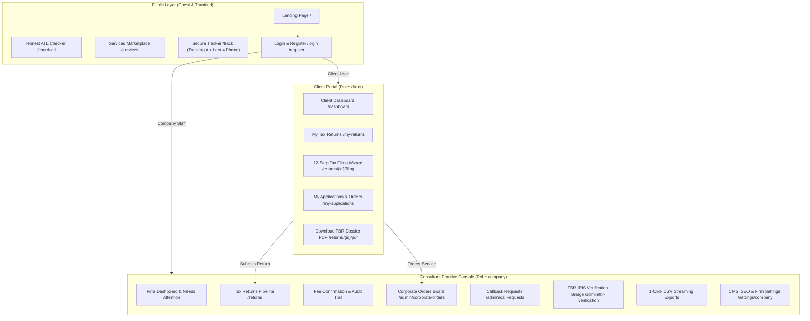
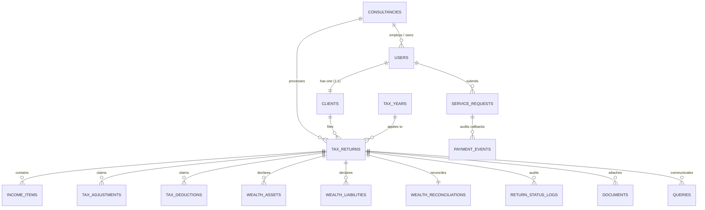
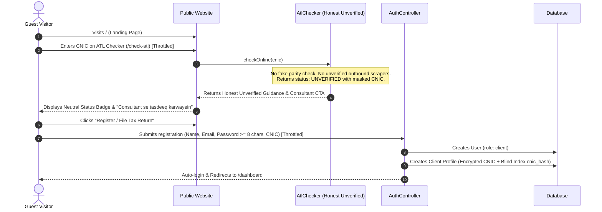
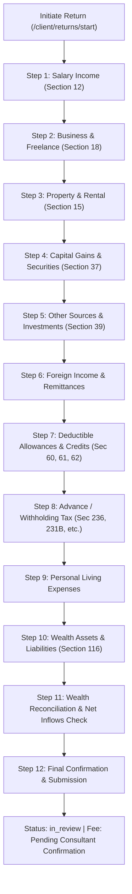
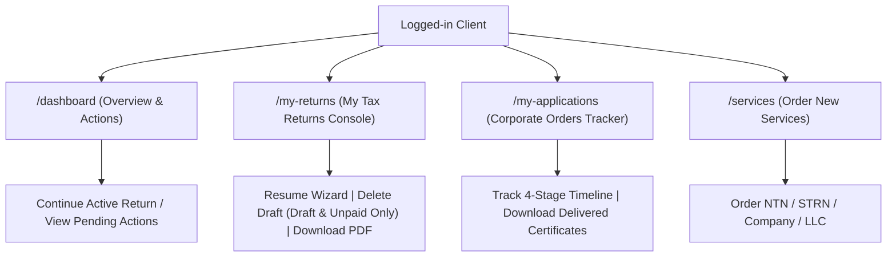
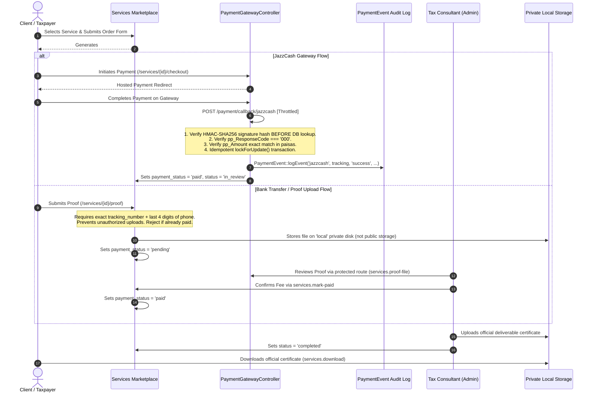
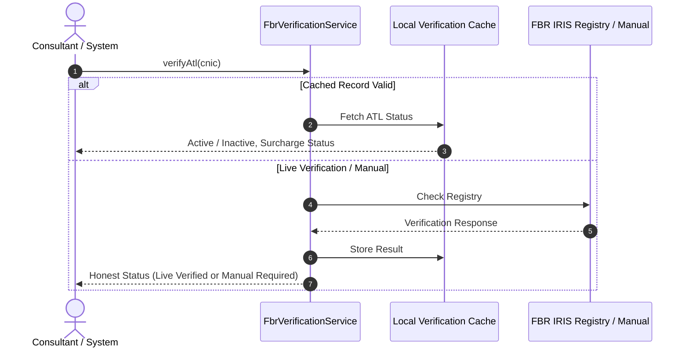
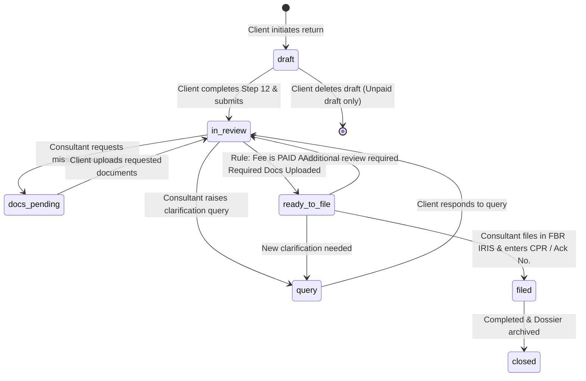

# Taxflilling Application Flow & Architectural Blueprint
**Platform:** TaxFiler.pk (Pakistan Digital Tax & Corporate Advisory Platform)  
**Stack:** Laravel 12/13 &bull; PHP 8.2+ &bull; Tailwind CSS v4 &bull; Alpine.js &bull; DomPDF &bull; SQLite / MySQL  
**Scope:** Complete End-to-End Functional, Technical, Security, and System Workflow Specification  

---

## Table of Contents
1. [Executive Architecture Overview](#1-executive-architecture-overview)
2. [Actor Roles & Permissions (RBAC Matrix)](#2-actor-roles--permissions-rbac-matrix)
3. [Database Models & Entity Relationships (ERD)](#3-database-models--entity-relationships-erd)
4. [Flow 1: Public Website & Client Onboarding](#4-flow-1-public-website--client-onboarding)
5. [Flow 2: Individual Income Tax Return (12-Step Wizard)](#5-flow-2-individual-income-tax-return-12-step-wizard)
6. [Flow 3: Client Portal Operations (Returns & Applications)](#6-flow-3-client-portal-operations-returns--applications)
7. [Flow 4: Corporate & NTN Services Order Lifecycle](#7-flow-4-corporate--ntn-services-order-lifecycle)
8. [Flow 5: Consultant & Firm Operations Console (Admin)](#8-flow-5-consultant--firm-operations-console-admin)
9. [Flow 6: FBR IRIS 2.0 Integration & Verification Bridge](#9-flow-6-fbr-iris-20-integration--verification-bridge)
10. [Security Controls, IDOR Protections & State Machines](#10-security-controls-idor-protections--state-machines)
11. [Complete Route Mapping Reference](#11-complete-route-mapping-reference)
12. [Verification & Automated Test Suite Metrics](#12-verification--automated-test-suite-metrics)

---

## 1. Executive Architecture Overview

TaxFiler.pk is a digital tax compliance and corporate filing platform modeled after Befiler and TurboTax, engineered specifically for Pakistan's Federal Board of Revenue (FBR) IRIS regulations, Income Tax Ordinance 2001, and SECP corporate laws.

### High-Level Architecture Diagram

---

## 2. Actor Roles & Permissions (RBAC Matrix)

The application enforces strict Role-Based Access Control via Laravel middleware (`role:client`, `role:company`), policy gates (`TaxReturnPolicy`), and perimeter security headers (`SecurityHeaders`):

| Capability / Resource | Guest (Public) | Client (Taxpayer) | Company (Consultant/Admin) |
|---|:---:|:---:|:---:|
| View Landing, ATL Checker, FAQs, Contact | ✅ | ✅ | ✅ |
| Browse Business Services Catalog | ✅ | ✅ | ✅ |
| Validate 13-digit CNIC format (`/services/check-cnic`) | ✅ (0 PII Leaked) | ✅ | ✅ |
| Track Application (`/track` + 4-digit phone verification) | ✅ | ✅ | ✅ |
| Access Client Dashboard (`/dashboard`) | ❌ | ✅ | ❌ (Redirects to Firm View) |
| Dedicated "My Tax Returns" (`/my-returns`) | ❌ | ✅ | ❌ (403 Forbidden) |
| Dedicated "My Applications" (`/my-applications`) | ❌ | ✅ | ❌ (403 Forbidden) |
| 12-Step Tax Return Wizard | ❌ | ✅ (Own returns only) | ✅ (Assigned returns) |
| Delete Draft Tax Return | ❌ | ✅ (Draft & Unpaid only) | ✅ |
| Confirm Return Filing Fee Received | ❌ | ❌ (403 Forbidden) | ✅ |
| Mark Corporate Order Paid (`services.mark-paid`) | ❌ | ❌ (403 Forbidden) | ✅ |
| Access Offline Payment Proofs (`services.proof-file`) | ❌ | ❌ (403 Forbidden) | ✅ |
| Transition Return Status (`in_review` ➔ `filed`) | ❌ | ❌ | ✅ |
| Corporate Orders & Leads Management | ❌ | ❌ | ✅ |
| FBR IRIS Verification Bridge | ❌ | ❌ | ✅ |
| Streaming CSV Data Exports | ❌ | ❌ | ✅ |
| Manage CMS & SEO Settings (`/admin/cms/*`) | ❌ | ❌ | ✅ |

---

## 3. Database Models & Entity Relationships (ERD)

### Core Schema & Data Protection Definitions:
- **`users`**: Authentication identity (`name`, `email`, `password`, `role` [`client`|`company`], `consultancy_id`, `is_active`).
- **`clients`**: Permanent taxpayer master profile (1:1 with `User`).
  - `user_id`: Foreign key reference to `users.id`.
  - `cnic`: **Encrypted at rest** via Laravel's `encrypt()` cast to prevent database leaks.
  - `cnic_hash`: **Deterministic blind index** (`hash_hmac('sha256', $cleanCnic, config('app.key'))`) allowing exact lookups (`whereCnic()`) without exposing plaintext CNIC in SQL.
  - `masked_cnic`: **Dynamic Eloquent accessor** (e.g., `42101-*******-1`), never stored as a database column.
  - `phone`, `email`, `ntn`.
- **`consultancies`**: Tenant / firm organization (`name`, `ntn`, `phone`, `email`, `address`, `bank_details`, `rates`).
- **`tax_years`**: Fiscal periods e.g. July 1 &ndash; June 30 (`name`, `filing_deadline`, `is_active`).
- **`tax_returns`**: Annual return filings (`client_id`, `tax_year_id`, `status` [`draft`, `docs_pending`, `query`, `in_review`, `ready_to_file`, `filed`, `closed`], `fee_status` [`pending`, `paid`], `fee_amount`, `taxable_income`, `tax_payable`, `iris_acknowledgement_no`).
- **`wealth_reconciliations`**: Balance sheet equation (`opening_wealth`, `net_inflows`, `living_expenses`, `other_outflows`, `closing_wealth`, `unreconciled_difference`).
- **`return_status_logs`**: Immutable audit log of status changes, who made them, and operational notes.
- **`service_requests`**: Corporate orders (NTN, STRN, Company, LLC) with 9-digit `tracking_number`, `fee_amount`, `payment_status` [`pending`, `paid`, `refunded`], `payment_proof_path` (stored securely on `local` private disk), `delivered_file_path`.
- **`payment_events`**: Immutable webhook & transaction audit trail:
  - `gateway`: Payment gateway (`jazzcash`).
  - `tracking_number`: Reference identifier.
  - `result`: Outcome (`success`, `rejected`, `already_processed`).
  - `reason`: Machine-readable reason or rejection cause.
  - `ip`: Client / gateway IP address.
  - `payload_hash`: SHA-256 fingerprint of raw webhook request data.
- **`callback_requests`**: Inbound customer lead requests (`name`, `phone`, `service_code`, `status` [`pending`, `contacted`, `converted`, `closed`]).
- **`documents`**: Encrypted document attachments linked to tax returns.
- **`queries`**: Bidirectional communication thread between consultant and client regarding filing clarifications.

---

## 4. Flow 1: Public Website & Client Onboarding

### Perimeter Security & Public Endpoint Controls:
1. **Rate Limiting**:
   - `throttle:login`: 5 attempts per minute.
   - `throttle:register`: 3 attempts per minute.
   - `throttle:public-lookup`: 10 requests per minute on `/check-atl`, `/track`, `/track/search`, `/services/check-cnic`, checkout initiation, and payment proof submission.
   - `throttle:payment-webhook`: 30 callbacks per minute.
2. **CNIC Format Validation (`/services/check-cnic`)**:
   - Accepts 13-digit CNIC, performs strictly mathematical and structural validation.
   - Leaks **zero** personally identifiable information (PII) to guests.
3. **Public Application Tracker (`/track`)**:
   - Prevents unauthorized data enumeration: requires both the exact 9-digit Tracking Number (`SR-XXXX-XXXX`) **and** verification of the last 4 digits of the applicant's registered phone number.
   - Guest partial CNIC lookup is deactivated.
4. **Security Headers Middleware (`SecurityHeaders`)**:
   - `X-Content-Type-Options: nosniff`
   - `X-Frame-Options: SAMEORIGIN`
   - `Referrer-Policy: strict-origin-when-cross-origin`
   - `Permissions-Policy: camera=(), microphone=(), geolocation=()`
   - `Strict-Transport-Security` automatically injected when serving over HTTPS.

---

## 5. Flow 2: Individual Income Tax Return (12-Step Wizard)

The tax filing workflow translates complex Pakistani income tax laws into an intuitive, guided self-service wizard (`/returns/{return}/filing`):

### Step-by-Step Breakdown:
1. **Step 1 (Salary Income - Section 12)**: Annual gross salary, tax-exempt medical and conveyance allowances, and tax already deducted by employer under Section 149.
2. **Step 2 (Business & Freelance - Section 18)**: Gross turnover/receipts, declared business expenses, and net calculated profit for sole proprietors, freelancers, and service providers.
3. **Step 3 (Property & Rental - Section 15)**: Gross rent received, 1/5th statutory repair allowance deduction, and municipal taxes.
4. **Step 4 (Capital Gains - Section 37)**: Stock exchange (PSX) gains, mutual fund redemptions, and real estate sale gains.
5. **Step 5 (Other Sources & Investments - Section 39)**: Bank profit/savings interest, dividend withholding, prizes, and investment income.
6. **Step 6 (Foreign Income & Remittances)**: Remittances received through official banking channels (PRC supported) and foreign assets income.
7. **Step 7 (Deductible Allowances & Tax Credits)**: Zakat paid under the Zakat Ordinance, educational fee allowance under Section 60D, and tax credits for donations to approved NPOs under Section 61.
8. **Step 8 (Advance / Withholding Tax Deductions)**: Mobile phone tax (Section 236), vehicle purchase/token tax (Section 231B), banking transaction tax, electricity bill tax, and property transaction withholding.
9. **Step 9 (Personal Living Expenses)**: Detailed household electricity, gas, water, domestic travel, vehicle maintenance, medical, and education costs.
10. **Step 10 (Wealth Statement - Assets & Liabilities - Section 116)**:
    - Declaration of commercial/residential properties, vehicles, bank account balances, cash, gold, and liabilities.
    - **FBR Authorization & Consent**: Contains an explicit authorization consent checkbox permitting the firm to file on the client's behalf.
    - **Zero Password Storage**: Plaintext FBR passwords or PINs are **never requested or stored**, protecting user credentials.
11. **Step 11 (Wealth Statement Reconciliation)**:
    $$\text{Closing Wealth} = \text{Opening Wealth} + \text{Inflows} - \text{Outflows (Expenses + Assets Acquired)}$$
    Mathematically validates that net declared wealth matches declared inflows and outflows to mitigate audit risk.
12. **Step 12 (Final Confirmation & Submission)**:
    - Summary review of tax computation and total refund/liability.
    - Submitting transitions status to `in_review`.
    - **Fee Status Rule**: The return's `fee_status` remains `pending` upon submission; clients cannot self-mark returns as paid. Fee confirmation is strictly authorized to the company consultant.

---

## 6. Flow 3: Client Portal Operations (Returns & Applications)

The Client Portal provides a unified personal financial center:

### Dedicated Portal Views:
1. **Dashboard (`/dashboard`)**:
   - Active filing progress card with live tax computation.
   - Pending action items (consultant queries, missing documents, fee notifications).
   - Safe `Delete Draft` action strictly allowed only when `status === 'draft'` and `fee_status !== 'paid'`.
2. **My Tax Returns (`/my-returns`)**:
   - Comprehensive multi-year filing history (e.g. 2026&ndash;2027, 2025&ndash;2026).
   - Displays Taxable Income, Net Tax Payable, Fee Status, and IRIS CPR Acknowledgment.
   - Contextual actions: Resume Wizard, Delete Draft, View Details, or **Download Official FBR Dossier PDF**.
3. **My Applications (`/my-applications`)**:
   - Real-time tracking of corporate orders.
   - Visual 4-stage pipeline: **1. Applied &rarr; 2. Fee Verified &rarr; 3. In Review &rarr; 4. Delivered**.
   - Direct download of delivered registration certificates (`services.download`).

---

## 7. Flow 4: Corporate & NTN Services Order Lifecycle

### Gateway & Callback Policy:
- **JazzCash**: Exclusively active online webhook gateway. Verified with HMAC-SHA256 signature calculation against secret merchant salt before database query.
- **EasyPaisa / 1Bill**: Disabled (HTTP 501 / route-restricted) until officially verified signature handlers and automated webhooks are implemented.
- **Fail-Closed Protection**: If credentials are missing in configuration, payment initiation gracefully catches `RuntimeException`, logs the exception, and returns an honest 503 response.

---

## 8. Flow 5: Consultant & Firm Operations Console (Admin)

The Company / Tax Consultant Console (`role:company`) equips tax lawyers and practitioners to manage practice operations:

```mermaid
flowchart LR
    subgraph FirmConsole["Practice Console (/dashboard)"]
        Attn["Needs Attention Queue (Unread queries, Ready to File)"]
        Finances["Financial Ledger (Collected Fees & Outstanding)"]
    end

    subgraph Operations["Firm Operations Boards"]
        Pipeline["Returns Pipeline (/returns)"]
        Orders["Corporate Orders Board (/admin/corporate-orders)"]
        Leads["Leads Board (/admin/call-requests)"]
        FBR["FBR Verification Bridge (/admin/fbr-verification)"]
        Export["Streaming Exports (Excel / CSV)"]
        CMS["CMS & SEO Marketing (/admin/cms/*)"]
        Settings["Firm Settings (/settings/company)"]
    end

    FirmConsole --> Operations
```

### Consultant Workflows:
1. **Tax Returns Pipeline (`/returns`)**:
   - Filterable by Status (`draft`, `docs_pending`, `query`, `in_review`, `ready_to_file`, `filed`, `closed`) and Tax Year.
   - Status modal supporting bidirectional transitions (e.g. moving between `in_review`, `query`, and `ready_to_file`).
2. **Fee Confirmation (`returns.confirm-fee`)**:
   - Strictly restricted to company staff via policy authorization.
   - Generates immutable audit records in `return_status_logs`.
3. **Corporate Orders Board (`/admin/corporate-orders`)**:
   - Real-time tabular tracking of service requests.
   - Safe access to payment proof receipts via protected route `services.proof-file`.
   - Manual fee confirmation via `services.mark-paid`.
4. **1-Click Streaming Exports**:
   - `/returns-export` &rarr; Full CSV export of returns, clients, incomes, and taxes.
   - `/clients-export` &rarr; Taxpayer roster with masked CNICs and contact numbers.
   - `/admin/corporate-orders/export` &rarr; Corporate orders financial ledger.
5. **CMS & SEO Management (`/admin/cms/seo`)**:
   - Manages meta tags, OpenGraph metadata, XML sitemap, and custom tracking scripts with security warnings.

---

## 9. Flow 6: FBR IRIS 2.0 Integration & Verification Bridge

The application communicates with FBR taxpayer verification systems through `App\Services\FbrVerificationService` and `App\Models\AtlChecker`:

### Verification Integrity Principles:
- **No Pseudo-Active Parity Logic**: Eliminated any legacy code that synthesized active status from CNIC parity.
- **Honest Status Reporting**: When live external APIs are unverified or offline, the system returns `UNVERIFIED` and prompts manual consultant verification.
- **Zero Third-Party Scraping Leaks**: No plain CNIC is leaked to unverified endpoints.

---

## 10. Security Controls, IDOR Protections & State Machines

### 10.1 IDOR Protection & Authorization Gates
Governed by `TaxReturnPolicy` and route middleware:
- `view(User $user, TaxReturn $return)`: Only the return's client owner or company consultants can view the return.
- `update(User $user, TaxReturn $return)`: Only the owner client or authorized consultant can update.
- `delete(User $user, TaxReturn $return)`:
  - **Clients**: Can ONLY delete their own return if `status === 'draft'` AND `fee_status !== 'paid'`.
  - Submitted, in-review, or paid returns cannot be deleted by clients (HTTP 403 Forbidden).
- `confirmFee(User $user, TaxReturn $return)`: Strictly restricted to `role:company`.
- Corporate order fee marking (`services.mark-paid`): Strictly restricted to `role:company`.

### 10.2 Tax Return Lifecycle State Machine

#### Transition Rules:
- **`ready_to_file` Preconditions**:
  1. Return `fee_status` MUST be `paid` (confirmed by company).
  2. All mandatory documents must be uploaded and verified.
- **Bidirectional Clarification**:
  - `in_review` &harr; `query`: Consultant can open a query at any point; resolving returns it to `in_review`.
  - `ready_to_file` &rarr; `in_review` / `query`: If an anomaly is spotted prior to IRIS submission, the return can be reverted.

### 10.3 Payment Integrity & Signature Verification
- **HMAC-SHA256 Verification Before DB Query**: In `PaymentGatewayController::handleCallback`, signature validity is verified prior to querying the database to prevent timing side-channel attacks and database enumeration.
- **Paisa-Level Amount Matching**: Expected fee in paisas (`(int) round($order->fee_amount * 100)`) must strictly equal `pp_Amount`.
- **Idempotency with DB Row Locking**: Webhook execution uses `DB::transaction()` with `lockForUpdate()`. If already paid, the callback returns `already_processed` without double crediting.
- **Audit Logging**: Every callback (success, declined, duplicate, or rejected) is logged into `payment_events` with IP, timestamp, and SHA-256 payload hash.
- **Private Storage**: Offline payment receipts are stored in the private local filesystem (`local` disk) and served only via authenticated staff route (`services.proof-file`).

---

## 11. Complete Route Mapping Reference

| HTTP Method | Route URI | Route Name | Controller Action | Access Gate / Middleware |
|---|---|---|---|---|
| `GET` | `/` | `home` | `HomeController@index` | Public |
| `GET` | `/services` | `services.index` | `BusinessServicesController@index` | Public |
| `POST` | `/services/check-cnic` | `services.check-cnic` | `BusinessServicesController@checkCnic` | Public, `throttle:public-lookup` |
| `POST` | `/services/apply` | `services.apply` | `BusinessServicesController@storeRequest` | Public |
| `POST` | `/services/callback` | `services.callback` | `BusinessServicesController@storeCallback` | Public |
| `POST` | `/services/{serviceRequest}/proof` | `services.payment-proof` | `BusinessServicesController@submitProof` | Public, `throttle:public-lookup` |
| `POST` | `/services/{serviceRequest}/checkout` | `payment.checkout` | `PaymentGatewayController@initiatePayment` | Public, `throttle:public-lookup` |
| `POST` | `/payment/callback/{gateway}` | `payment.callback` | `PaymentGatewayController@handleCallback` | Public, `where: jazzcash`, `throttle:payment-webhook` |
| `POST` | `/check-atl` | `atl.check` | `AtlCheckerController@check` | Public, `throttle:public-lookup` |
| `GET` | `/track` | `track` | `TrackController@index` | Public, `throttle:public-lookup` |
| `GET` | `/track/search` | `track.search` | `TrackController@search` | Public, `throttle:public-lookup` |
| `GET` | `/faq` | `faq` | Inline view (`faq`) | Public |
| `GET` | `/contact` | `contact` | Inline view (`contact`) | Public |
| `GET` | `/p/{slug}` | `pages.show` | `PageViewController@show` | Public |
| `GET` | `/sitemap.xml` | `sitemap` | `SitemapController@index` | Public |
| `GET` | `/login` / `/register` | `login` / `register` | `AuthController` | Guest |
| `POST` | `/login` | `login.submit` | `AuthController@login` | Guest, `throttle:login` |
| `POST` | `/register` | `register.submit` | `AuthController@register` | Guest, `throttle:register` |
| `POST` | `/logout` | `logout` | `AuthController@logout` | `auth` |
| `GET` | `/dashboard` | `dashboard` | `DashboardController@index` | `auth` |
| `GET` | `/returns/{return}/filing` | `wizard.filing` | `FilingWizardController@show` | `auth` |
| `POST` | `/returns/{return}/filing/{step}` | `wizard.filing.save` | `FilingWizardController@saveStep` | `auth` |
| `GET` | `/returns/{return}/pdf` | `returns.pdf` | `PdfDossierController@generateReturnDossier` | `auth` |
| `GET` | `/applications/{serviceRequest}/download` | `services.download` | `BusinessServicesController@downloadDeliverable` | `auth` |
| `GET` | `/my-returns` | `client.returns` | `TaxReturnController@clientIndex` | `role:client` |
| `POST` | `/client/returns/start` | `client.returns.start` | `DashboardController@startReturn` | `role:client` |
| `DELETE` | `/my-returns/{return}` | `client.returns.destroy` | `TaxReturnController@destroy` | `role:client` |
| `GET` | `/my-applications` | `client.applications` | `BusinessServicesController@clientApplications` | `role:client` |
| `GET` | `/returns` | `returns.index` | `TaxReturnController@index` | `role:company` |
| `POST` | `/returns/{return}/status` | `returns.status` | `TaxReturnController@transitionStatus` | `role:company` |
| `POST` | `/returns/{return}/confirm-fee` | `returns.confirm-fee` | `TaxReturnController@confirmFee` | `role:company` |
| `GET` | `/clients` | `clients.index` | `ClientController@index` | `role:company` |
| `GET` | `/admin/corporate-orders` | `admin.orders.index` | `CorporateOrderController@index` | `role:company` |
| `POST` | `/admin/corporate-orders/{serviceRequest}/status` | `admin.orders.status` | `CorporateOrderController@updateStatus` | `role:company` |
| `POST` | `/admin/corporate-orders/{serviceRequest}/mark-paid` | `services.mark-paid` | `BusinessServicesController@markPaid` | `role:company` |
| `GET` | `/services/{serviceRequest}/proof-file` | `services.proof-file` | Closure (Storage stream) | `role:company` |
| `GET` | `/admin/call-requests` | `admin.callbacks.index` | `CallRequestController@index` | `role:company` |
| `GET` | `/admin/fbr-verification` | `admin.fbr.index` | `FbrVerificationController@index` | `role:company` |
| `POST` | `/admin/fbr-verification/verify` | `admin.fbr.verify` | `FbrVerificationController@verify` | `role:company` |
| `GET` | `/admin/corporate-orders/export` | `admin.orders.export` | `ReportExportController@exportOrders` | `role:company` |
| `GET` | `/returns-export` | `returns.export` | `ReportExportController@exportReturns` | `role:company` |
| `GET` | `/clients-export` | `clients.export` | `ReportExportController@exportClients` | `role:company` |
| `GET` | `/settings/company` | `settings.company` | `CompanySettingsController@show` | `role:company` |
| `POST` | `/settings/company` | `settings.company.update` | `CompanySettingsController@update` | `role:company` |
| `GET` | `/admin/cms/seo` | `admin.cms.seo.index` | `SeoMarketingController@index` | `role:company` |
| `POST` | `/admin/cms/seo` | `admin.cms.seo.update` | `SeoMarketingController@update` | `role:company` |
| `GET` | `/admin/cms/services` | `admin.cms.services.index` | `CmsServiceController@index` | `role:company` |
| `GET` | `/admin/cms/categories` | `admin.cms.categories.index` | `ServiceCategoryController@index` | `role:company` |
| `GET` | `/admin/cms/menus` | `admin.cms.menus.index` | `MenuController@index` | `role:company` |
| `GET` | `/admin/cms/faqs` | `admin.cms.faqs.index` | `CmsFaqController@index` | `role:company` |
| `GET` | `/admin/cms/site` | `admin.cms.site.index` | `CmsSiteContentController@index` | `role:company` |

---

## 12. Verification & Automated Test Suite Metrics

The application is validated by an automated PHPUnit / Pest test suite covering unit, security, integration, and IDOR protection layers:

- **Total Tests Executed:** 66
- **Total Passing:** 65 (1 skipped)
- **Total Assertions:** 283
- **Test Suites Included:**
  - `SecurityAndOwnershipTest`: 21 tests (82 assertions) verifying IDOR protections, fail-closed payment credentials, blind-index `cnic_hash` lookups, proof upload phone verification, private disk storage, `payment_events` audit logging, and `SecurityHeaders`.
  - `AtlCheckerTest`: 3 tests (17 assertions) verifying honest `UNVERIFIED` output, parity neutrality, `Http::assertNothingSent()`, and PII masking.
  - `BusinessServicesTest`: Order workflow, tracking verification, and status updates.
  - `TaxReturnPolicyTest` & `FilingWizardTest`: Complete 12-step validation, fee confirmation constraints, and draft lifecycle rules.
